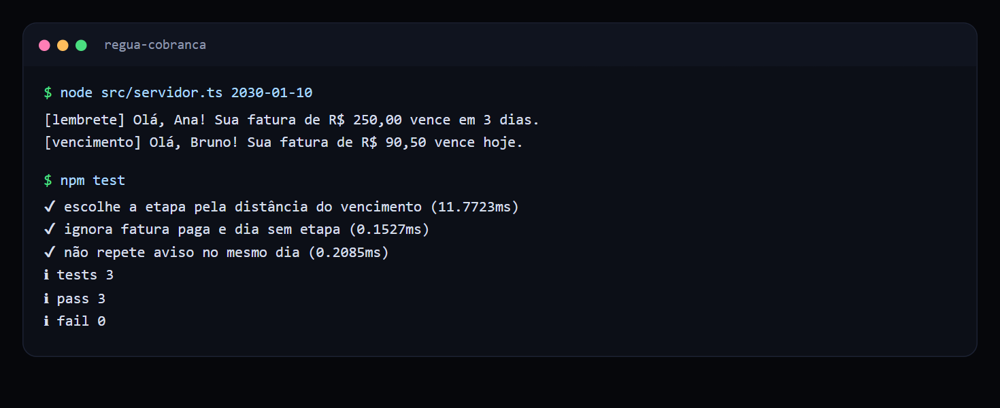
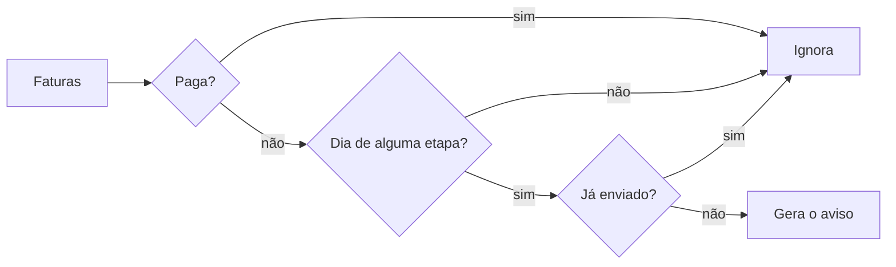

# Régua de cobrança automática

Automação que decide quais avisos de cobrança enviar a cada dia, sem esquecer nenhum cliente e sem mandar a mesma mensagem duas vezes.

 

## Veja funcionando



*Avisos gerados para o dia simulado e testes passando.*

## O problema

Cobrar manualmente toma tempo do financeiro e depende de lembrar. Quando a cobrança atrasa, o dinheiro atrasa junto. E uma automação malfeita, que repete mensagem, irrita justamente quem você quer manter como cliente.

## O que ela faz

| Quando | Etapa | Mensagem |
| --- | --- | --- |
| 3 dias antes | `lembrete` | Vence em 3 dias |
| No dia | `vencimento` | Vence hoje |
| 3 dias depois | `atraso` | Está 3 dias em atraso |
| 10 dias depois | `negociacao` | Convite para negociar |

Faturas pagas ficam de fora automaticamente.

## Como funciona



## Decisões técnicas

| Decisão | Motivo |
| --- | --- |
| Execução idempotente | A chave `fatura:etapa` permite rodar o agendador de novo sem duplicar envio. |
| Data recebida por parâmetro | Qualquer dia pode ser simulado nos testes. |
| Etapas em uma lista | Mudar a régua é editar dados, sem mexer na lógica. |

## Como rodar

Requer Node.js 24 ou superior.

```bash
npm test
node src/servidor.ts 2030-01-10
```

```text
[lembrete] Olá, Ana! Sua fatura de R$ 250,00 vence em 3 dias.
[vencimento] Olá, Bruno! Sua fatura de R$ 90,50 vence hoje.
```

## Próximos passos

- Enviar pelo WhatsApp e por e-mail.
- Guardar os envios em banco, para valer entre execuções.
- Gerar link de Pix em cada aviso.

## Sobre este projeto

Projeto de demonstração, com dados e empresas fictícios, criado para mostrar a abordagem técnica de forma simples.

## Autor

**Luiz Renato Carvalho**, Engenheiro de Software e IA · [luizrenato.dev](https://www.luizrenato.dev) · [LinkedIn](https://linkedin.com/in/luizrenatodc)
